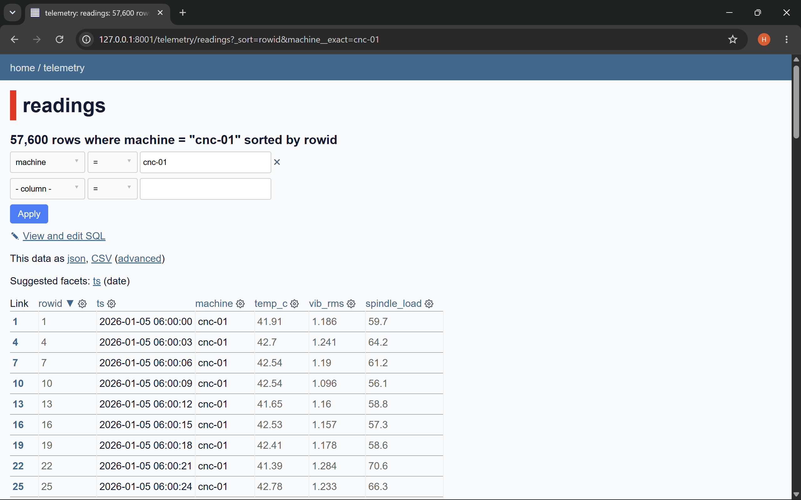

# Task 8 — Publish Data with Datasette

## 1. Database

I used Datasette to explore my SQLite database, `telemetry.db`, in a web browser.

The database contains 172,800 rows in the `readings` table.

## 2. Filtered Data

I filtered the `readings` table using:

- Column: `machine`
- Operator: `=`
- Value: `cnc-01`

**Result:** 57,600 rows.

## 3. CSV Export

I exported the filtered data using Datasette's advanced CSV export options.

Exported file: [telemetry-cnc-01.csv](telemetry-cnc-01.csv)

## 4. Screenshot Evidence

## 5. Single Row URL

http://127.0.0.1:8001/telemetry/readings/1

This URL opens row 1 in my local Datasette server. It is accessible only when the local server is running.

## 6. What I Learned

I learned how to use Datasette to browse a SQLite database, filter records, export data to CSV, and inspect individual rows without writing SQL manually.