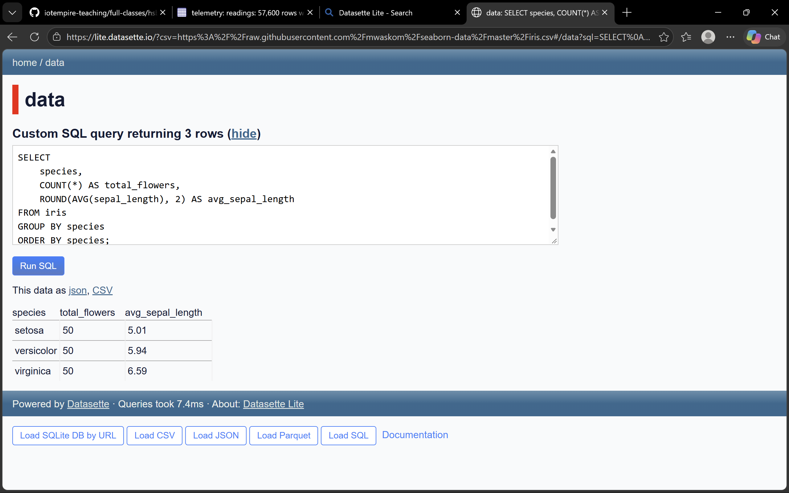

# Task 11 — Datasette Lite & sqlite-utils

## 1. Introduction

In this task, I explored different tools for working with SQLite databases:

- Datasette Lite
- sqlite-utils
- SQLite command-line interface (sqlite3)
- Python's sqlite3 module

I compared how these tools can load, inspect, and query data.

## 2. Datasette Lite

I opened Datasette Lite in my browser:

https://lite.datasette.io/

I loaded the public Iris CSV dataset from:

https://raw.githubusercontent.com/mwaskom/seaborn-data/master/iris.csv

The dataset contained 150 flower records.

I executed this SQL query:

```sql
SELECT
    species,
    COUNT(*) AS total_flowers,
    ROUND(AVG(sepal_length), 2) AS avg_sepal_length
FROM iris
GROUP BY species
ORDER BY species;
```

### Results

| Species | Total flowers | Average sepal length (cm) |
|---|---:|---:|
| setosa | 50 | 5.01 |
| versicolor | 50 | 5.94 |
| virginica | 50 | 6.59 |

Datasette Lite allowed me to load and query data directly in my browser.

### Screenshot



## 3. Working with sqlite-utils

I used sqlite-utils to inspect my telemetry database.

### List tables

```powershell
uv run sqlite-utils tables Module01/telemetry.db
```

Result: `readings`

### Inspect the schema

```powershell
uv run sqlite-utils schema Module01/telemetry.db
```

The readings table contained five columns:

- ts
- machine
- temp_c
- vib_rms
- spindle_load

### Read five records

```powershell
uv run sqlite-utils rows Module01/telemetry.db readings --limit 5
```

### Display records as CSV

```powershell
uv run sqlite-utils rows Module01/telemetry.db readings --limit 5 --csv
```

## 4. Importing CSV Data

I imported telemetry.csv into a separate test database.

```powershell
uv run sqlite-utils insert Module01/toolbox-test.db readings Module01/telemetry.csv --csv
```

I verified the number of imported records:

```powershell
uv run sqlite-utils query Module01/toolbox-test.db "SELECT COUNT(*) AS total_rows FROM readings;"
```

Result: 172,800 records.

This confirmed that the CSV import was successful.

## 5. Full-Text Search

I enabled full-text search on the machine column:

```powershell
uv run sqlite-utils enable-fts Module01/toolbox-test.db readings machine
```

Then I searched for CNC machine records:

```powershell
uv run sqlite-utils search Module01/toolbox-test.db readings "cnc" --limit 5
```

The search returned five matching records.

I learned that FTS can search text values using a special search index.

## 6. Python sqlite3 Module

I tested Python's built-in sqlite3 module:

```powershell
uv run python -c "import sqlite3; db = sqlite3.connect('Module01/telemetry.db'); print(db.execute('SELECT COUNT(*) FROM readings').fetchone()); db.close()"
```

Output:

```text
(172800,)
```

Python successfully connected to my database and executed a SQL query.

## 7. Comparison of Three SQLite Tools

| Feature | sqlite3 | sqlite-utils | Python sqlite3 |
|---|---|---|---|
| Execute SQL | Yes | Yes | Yes |
| Inspect tables | Yes | Yes | Yes |
| Import CSV | Extra commands | Simple command | Python code |
| Export data | Yes | Yes | Python code |
| Main advantage | Interactive SQL | Convenient CLI | Programmability |

### Which required the fewest keystrokes?

For CSV importing, sqlite-utils required the fewest commands.

### Which was the clearest?

I found the sqlite3 shell clearest for learning SQL because I could execute queries interactively.

### When would I use each tool?

I would use sqlite3 to practise SQL queries, sqlite-utils for quick database operations, and Python's sqlite3 module for automated applications.

## 8. Reflection

Datasette Lite was useful because I could explore data without installing a database server.

sqlite-utils simplified tasks such as importing CSV files and searching text.

Python's sqlite3 module was useful for understanding how applications interact with databases.

I learned that different tools can work with the same SQLite database, but each is better suited to particular tasks.
