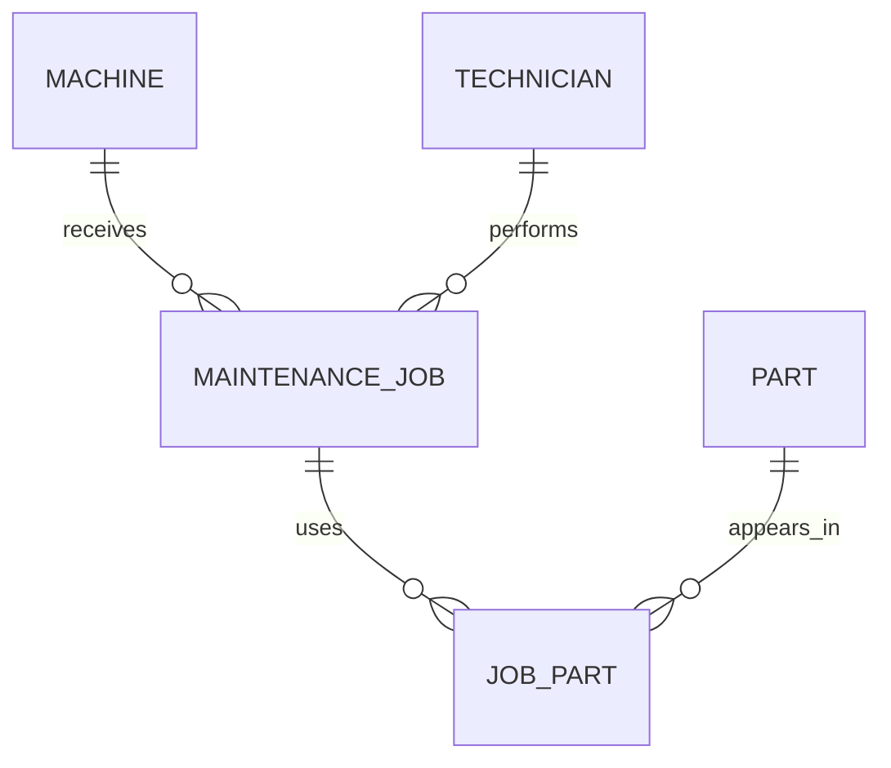

# ER audit and executable contract

Existing legacy.dp is SQL, not a database; setup.sql preserves it under an explicit extension. legacy.db was opened read-only. [Executed defect queries](evidence/results.json) prove orphan job 3/cnc-05, duplicate P-1003, invalid installation date, TEXT price comparison and list-valued join failure. Text comparison omits the cheap 9.90 part; the cast comparison shows it. The naive list join drops job 1 and duplicates job 2 through duplicate part rows. These cause unassigned maintenance, inconsistent catalog facts, wrong price filters and incomplete/double-counted reports.

Intended entities: Machine(machine_id surrogate PK, serial_no natural UNIQUE, site, installed), Part(part_no natural PK, description, unit_price), MaintenanceJob(job_id PK, machine_id FK, technician, done_on), Technician(technician_id proposed PK, name), JobPart(job_id + part_no composite PK). Observed counts do not prove domain cardinality: a machine can have zero/many jobs; a job references one machine, and jobs and parts have a many-to-many relationship. The legacy text fields hide these constraints. No genuine 1:1 relationship is established. A technician is an entity if independently managed; the supplied contract keeps its name as an attribute until that requirement is confirmed.

The diagram is a proposed model, not an automatic reading of enforced legacy FKs (there are none). Pydantic Machine validates positive IDs, actual dates and SN- prefix. SQLAlchemy provides required columns, serial uniqueness, keys and relationships; [emitted DDL](evidence/corrected.sql) builds in memory. Three invalid-model cases are actually rejected. Pydantic does not check cross-row FK/uniqueness; SQLite needs foreign_keys=ON on every connection. SQLite DATE/NUMERIC affinity alone does not guarantee valid dates or fixed decimal currency for raw SQL; production money should use integer cents and additional checks. No ambiguous legacy records were silently migrated: cnc-05 needs reconciliation; 'unknown' date needs a documented policy. Optional EER inheritance is not included.
