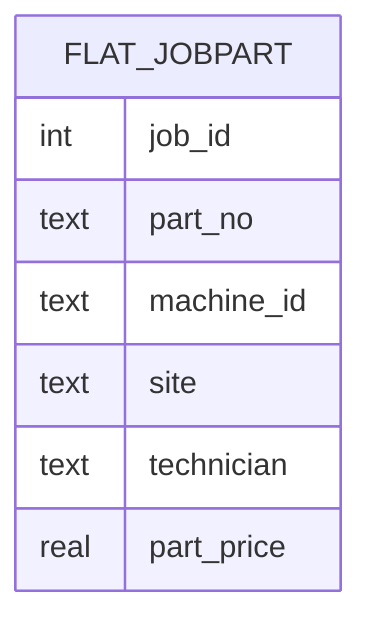
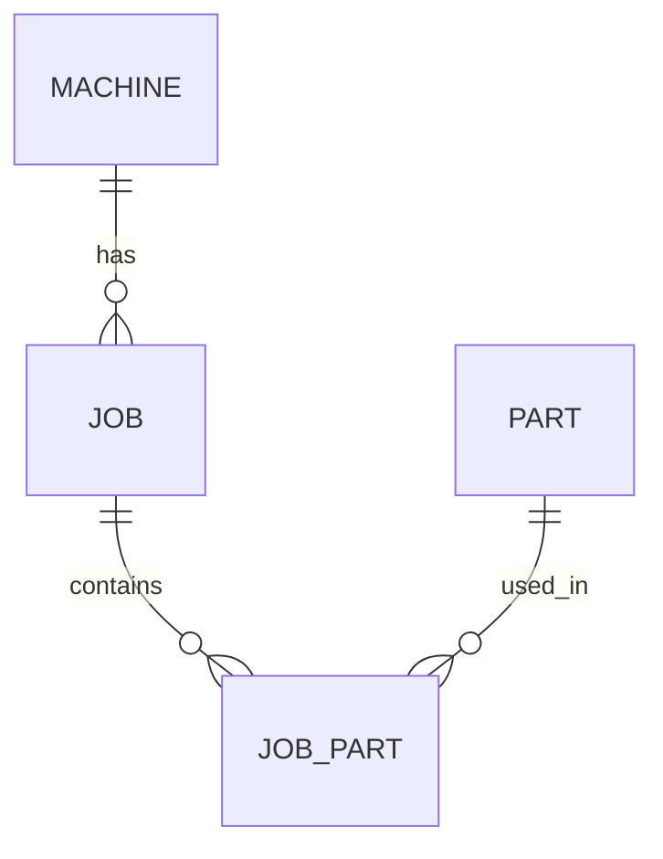

# Normalization notes and provisional memo

No Module05 implementation existed. setup.sql derives 200,000 rows from 20,000 jobs × 10 parts, then reconstructs 3NF and a reporting copy. FKs are enabled. Counts, reverse EXCEPT comparison and matched dashboard rows verify the decomposition. Parts are P-0002 through P-0011: k ranges 1–10, so modulo 40 does not create 40 parts.

Assumed domain FDs: job_id → machine_id,technician,done_on; machine_id → site; part_no → part_price. Candidate key is (job_id,part_no) when the domain guarantees one row per part per job. The sample does not establish machine_id → technician; the generator cycles them independently. 1NF removes lists; 2NF removes part-price and job attributes dependent on only part of the composite key; 3NF removes site via machine_id. Numeric storage alone is not normalization.

Executed five-row anomaly fixture: changing one copied site produces two sites for cnc-01; adding an unused part requires a row without a job; deleting the last P-0002 association loses its only price fact. Raw outputs are recorded. In 3NF an unused part and machine relocation are independent of jobs.

Actual interleaved median: normalized 114.227 ms; report 130.288 ms. Dropped-index median 92.891 ms. Site change touches 1 normalized row versus 4000 report rows. Update timings exclude commit and are rolled back to preserve the baseline. dbstat records table/index page bytes separately; table-only space is not full database overhead.

Provisional engineering memo to Yasmin (AI-prepared, not a personally defended choice): Keep transactional truth normalized. Choose the dashboard path from measured plans and medians rather than assuming one table always wins. The report repeats site/technician/price and multiplies update work. Use a transactionally consistent scheduled rebuild for a reporting snapshot rather than independent edits to copied facts. Publish the snapshot only after counts and content checks pass. Monitor last successful refresh time and refuse or label stale reports; the operator and permitted lag still require stakeholder agreement. [STUDENT INPUT REQUIRED: Read the memo to a neighbour, defend it, record the what-if and your final decision.]
